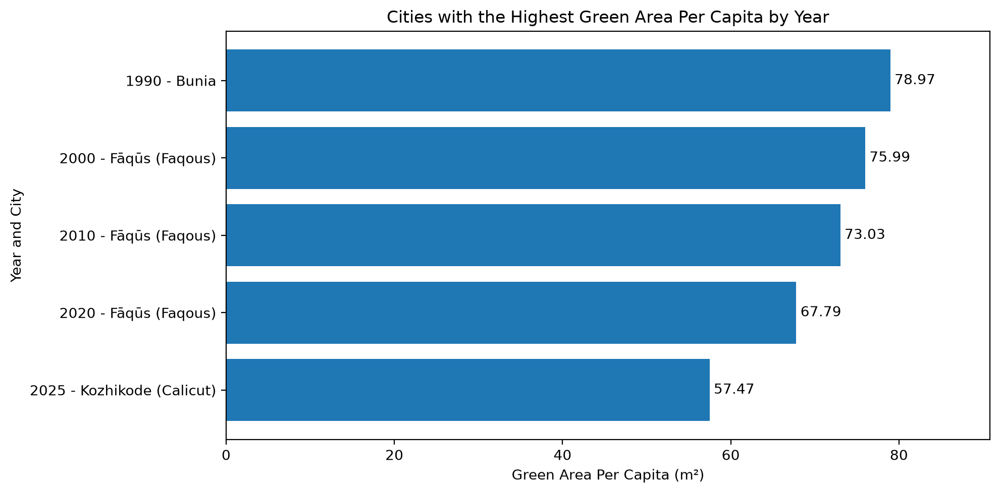

# Urban Green Space Analysis

### STAT 159 — Lab 11

**Zhecen Zhou**

TidyTuesday Dataset — September 22, 2026

---

## Dataset Overview

**Source:** TidyTuesday (September 22, 2026)

**Original Data:** UN-Habitat Urban Indicators Database

- 5,600 observations
- 1,105 unique city names
- Five years: 1990, 2000, 2010, 2020, 2025
- Key variable: Green Area Per Capita (m²)

---

## Research Question & Methodology

**Research Question**

Which city has the most green area per capita in each year?

**Methodology**

1. Load the TidyTuesday dataset using Pandas.
2. Check missing values and duplicate observations.
3. Remove records with missing values in key variables.
4. Group observations by year using `groupby()`.
5. Use `idxmax()` to identify the highest value in each year.

---

## Results: Top City by Year

**Key Observation:** Fāqūs ranked first in 2000, 2010, and 2020.

---

## Key Findings & Conclusion

### Key Findings

- **Fāqūs (Faqous)** ranked first in 2000, 2010, and 2020.
- The highest observed green area per capita decreased from **78.97 m² (1990)** to **57.47 m² (2025)**.
- The top-ranked city changed across the five observed years.

### Conclusion

Urban green space availability varies across cities and years.

However, the decline in annual maximum values does not necessarily indicate an overall decline in urban green space.

### Limitations

- Missing observations may affect the rankings.
- Only five years are available for comparison.

---

